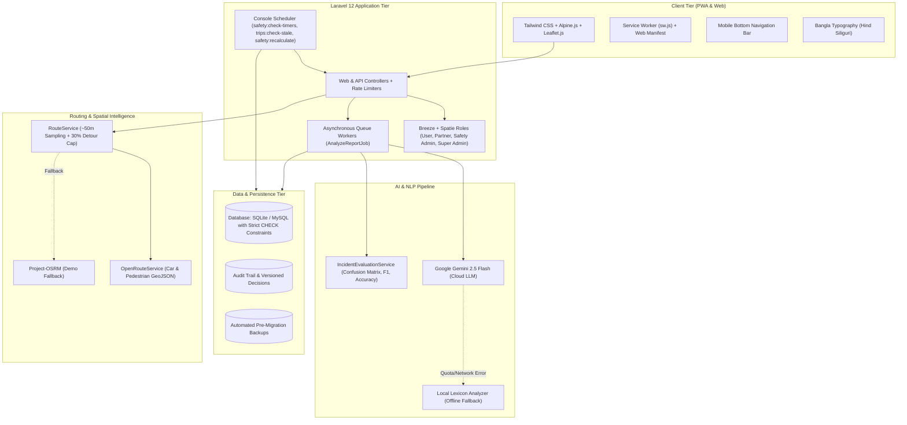
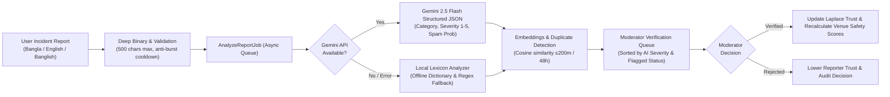
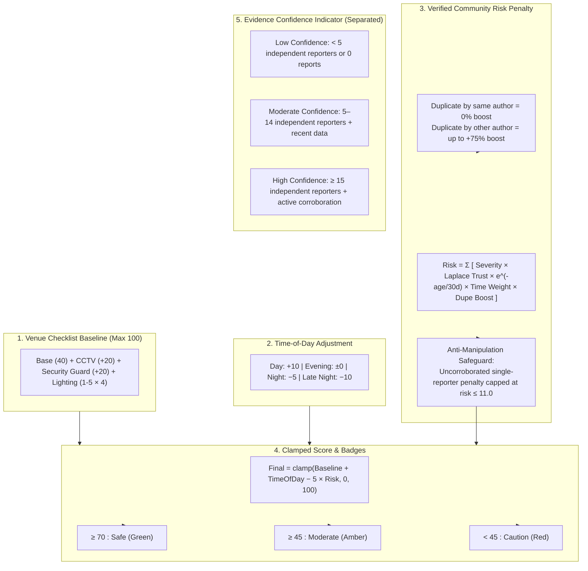

# 🌙 NightLifeBD — Bangla-First AI Safety Intelligence Web Application

A modern, production-hardened Laravel 12 application (installable Progressive Web App) turning real community nighttime experiences — submitted in **Bangla, English, or Banglish** — into actionable, explainable safety intelligence: a **time-aware, explainable venue safety score with evidence confidence levels**, **multi-objective safest vs. fastest walking & driving routes**, **live spatial heatmaps**, an **AI night planner (RAG)**, a **venue right-of-reply system**, and an **emergency safety toolkit** (SOS, live trip tracking, safety timer, fake call, and dead-man stale trip alerts).

**Team Error 404** — Daffodil International University (DIU), SE331 Software Engineering Design Capstone (Fall 2026)  
*Ridwan Mahmud (232-35-525) · Shahed Ahmed (232-35-033) · Maruf Ahmed (232-35-447)*

> ⚠️ **Safety Disclaimer**: Safety information is community-sourced and AI-assisted. It is strictly advisory and never replaces emergency services (**999**). All demo records are fictional.

---

## 1. System Architecture & Workflows

### 1.1 High-Level Architecture


---

### 1.2 AI Incident Classification & Guardrail Pipeline


---

### 1.3 Explainable Safety Score & Confidence Engine


---

## 2. Completed Master Development Phases

### Phase 1: Security and Database Reliability
* **Environment Security**: Excluded `.env` from Git tracking and distributable archives; `.env.example` verified with placeholders; local keys kept intact.
* **Database Integrity**:
  * Added self-referencing foreign key on `reports.duplicate_of` with `restrictOnDelete()` and Eloquent duplicate promotion lifecycle hook (earliest duplicate promoted to root upon parent deletion).
  * Added MySQL/SQLite CHECK constraints: `reports.severity` (1–5), `reports.rating` (1–5), `venues.lighting` (1–5), and `venues.price_tier` (1–3).
  * Added `SoftDeletes` on reports preserving historical evidence.
* **Flash-Free Dark Mode**: Instant theme initialization before page render avoiding FOUC; synchronized toggle icons (`🌙`/`☀️`) across navigation, guest layouts, and modals.
* **WCAG AA Accessibility**: Accessible safety badge component (`<x-badge />`) with icons, semantic labels, `role="status"`, and contrast-compliant palettes.

### Phase 2: Safety Intelligence and Trust System
* **Safety-Score Confidence System**:
  * Distinct 3-tier confidence indicator (`Low`, `Moderate`, `High`) representing corroboration strength, independent reporters, and recency ($\le 60$ days).
  * Venues with 0 community reports explicitly explain that score is derived solely from physical security features.
  * Duplicate reports count as corroboration for parent reports but are strictly excluded from independent reporter counts.
* **Abuse Resistance & Trust Hardening**:
  * Laplace trust score bounded between $[0.10, 0.90]$ in `User::recalcTrust()`.
  * Duplicate boost strictly requires `user_id != root->user_id` (self-duplicates yield 0% boost).
  * Uncorroborated single-reporter penalty damping (capped at `risk = 11.0` until independent multi-user corroboration).
  * 24-hour per-user, per-venue report cooldown to prevent targeted score harassment.
  * Velocity burst detector ($\ge 3$ reports in 10 minutes) automatically flags reports with `needs_review = true` and records audit entries.
* **AI vs. Moderator Evaluation Dashboard**:
  * Persists raw AI classifications (`ai_category`, `ai_severity`) alongside human-moderated outcomes.
  * Interactive admin evaluation dashboard computing Category Accuracy, Macro F1-Score, Severity Agreement (MAE), $7 \times 7$ Confusion Matrix, and Head-to-Head Comparison (Gemini AI vs. Local Lexicon Analyzer).

### Phase 3: New Functionality
* **Walking Route Functionality**: Pedestrian profiles on OpenRouteService (`foot-walking`) and OSRM with realistic walking speed calculation ($1.33\text{ m/s}$), mode selector toggle (🚗 Driving / 🚶 Walking), and mode-specific caching.
* **Venue Right-of-Reply**: `report_responses` table allowing authorized venue owners to post official statements on reports regarding their venues; includes moderator approval/rejection queue and public display callouts.
* **Pending Report Management**: Report authors can view, edit, or withdraw their own pending reports; edits reset classifications and automatically re-dispatch `AnalyzeReportJob`; verified or rejected reports are locked against edits.
* **Abuse Reporting (Flagging)**: Community report flagging system with unique constraint `['report_id', 'user_id']` preventing repeat flags, auto-elevation to `needs_review` upon $\ge 3$ flags, and an admin moderation queue with dismissal, report rejection, and user ban actions.
* **Stale Live-Trip Emergency Alerts**: Inactive trip monitor (`trips:check-stale`) alerting emergency contacts when an active trip stops pinging for 15+ minutes or stalls past duration; includes dead-man switch deduplication (`stale_alerted_at`).
* **Data Privacy, Export & Safe Deletion**: Self-service JSON personal data export (`GET /profile/export`); safe account deletion disassociating community reports (`user_id = null`, `is_anonymous = true`) to preserve community venue safety scores without foreign key errors.

### Phase 4: UI, UX and Presentation
* **Mobile Bottom Navigation Bar**: Fixed, thumb-friendly bottom navigation bar for mobile viewports (`md:hidden`) with quick access to Explore, Safe Route, Near Me, SOS, and Profile.
* **Onboarding Safety Circle Prompt**: Welcoming, explanatory setup card on user dashboard encouraging new users to configure emergency contacts for live trips and SOS alerts.
* **Actionable Empty States**: Engaging, illustrated empty-state components across contacts, reports, venues, and live trips.
* **Bangla Typography**: Integrated Google Font `Hind Siliguri` alongside Figtree in Tailwind configuration for native Bangla glyphs and line heights.

---

## 3. Quick Start (Windows / Local Development)

### One-Click Launchers (Root Directory)
* **`RUN_APP.bat`**: Automatic one-click launcher starting Laravel server and Vite assets.
* **`run.bat`**: Interactive control menu (Run App, Run Tests, Recalculate Scores, Demo Reset).
* **`RESET_DEMO.bat`**: Resets all demo trips, timers, and flags without wiping seed data.

### Manual Setup
```bash
cd nightlifebd-main
composer install
npm install
copy .env.example .env
php artisan key:generate
php artisan migrate
npm run build
php artisan serve
```

---

## 4. Test Suite & Verification

The project includes a comprehensive suite of **195 automated tests with 737 assertions** passing with zero errors or warnings:

```bash
# Run the complete test suite
php artisan test

# Run tests by phase
php artisan test --filter=Phase1SecurityAndIntegrityTest
php artisan test --filter=Phase2SafetyAndEvaluationTest
php artisan test --filter=Phase3NewFunctionalityTest
```

### Test Coverage Highlights:
- **Phase 1**: CHECK constraints range enforcement (severity, rating, lighting, price tier), duplicate deletion promotion, accessibility badge contrast, `.gitignore` exclusions.
- **Phase 2**: Multi-tier confidence calculation, duplicate boost suppression for same author, solo-reporter damping, 24h venue cooldown, velocity burst detection, evaluation confusion matrix & F1-score calculation.
- **Phase 3**: Walking route computation & mode validation, venue right-of-reply authorization & moderation, pending report editing & withdrawal, abuse flagging & duplicate prevention, stale live trip notifications, JSON data export, safe account deletion disassociation.
- **Regression Suite**: Route scoring & detour caps, offline AI classification (Bangla/Banglish/English), emergency contacts & SOS dispatch, health checks, rate limiting, and end-to-end smoke tests.

---

## 5. Technology Stack

- **Framework**: Laravel 12 (PHP 8.2+)
- **Frontend**: Blade, Tailwind CSS (Dark Mode: Class), Alpine.js, Leaflet.js
- **Typography**: Figtree (English) & Hind Siliguri / Noto Sans Bengali (Bangla)
- **AI Integration**: Google Gemini 2.5 Flash API + Built-in Bangla/Banglish Keyword Lexicon Fallback
- **Spatial & Maps**: OpenStreetMap, OpenRouteService API, Project-OSRM Fallback
- **Database**: SQLite (Development & Testing) / MySQL UTF8mb4
- **Testing**: PHPUnit 11 / Laravel Testing Framework
